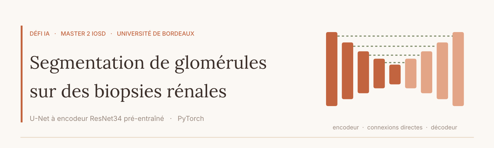
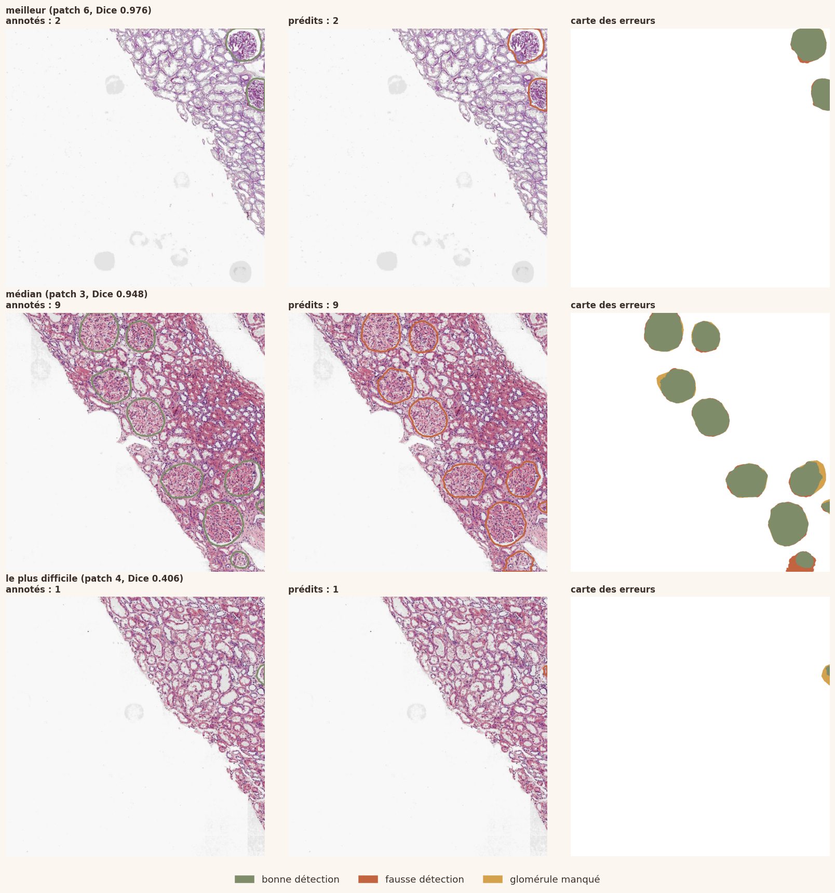
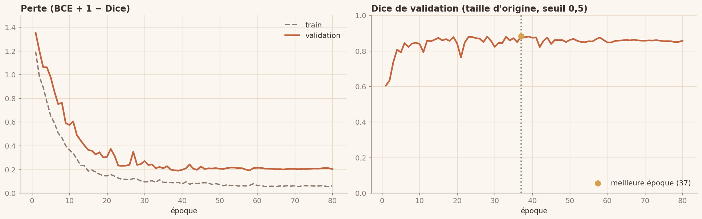

<p align="center">
  
</p>

<p align="center">
  
  
  
  
</p>

# Segmentation de glomérules sur des biopsies rénales

Défi IA du Master 2 IOSD (Image, Optimisation et Sciences des Données), Université de Bordeaux, réalisé en binôme.

Les glomérules sont les unités de filtration du rein. Sur une biopsie, le pathologiste les repère pour diagnostiquer une maladie rénale chronique : un travail long et en partie subjectif. L'objectif est de prédire automatiquement leur masque sur des images histologiques de 1024 × 1024 pixels, avec le coefficient de Dice comme score.

**[Voir le notebook](segmentation_glomerules.ipynb)** · [version mise en forme (nbviewer)](https://nbviewer.org/github/yayefatou-lam/segmentation-glomerules/blob/main/segmentation_glomerules.ipynb)

## En bref

- **Données :** 53 patchs annotés issus de deux lames, plusieurs colorations (HE, PAS, PASM…), glomérules sur environ 5 % des pixels.
- **Modèle :** U-Net dont l'encodeur est un ResNet34 pré-entraîné sur ImageNet (24,5 millions de paramètres), deux pas d'apprentissage et décroissance en cosinus.
- **Entraînement :** morceaux de 512 × 512 en pleine résolution tirés à la volée, augmentation géométrique et de coloration, prédiction sur l'image entière.
- **Méthode :** découpage 70 / 15 / 15 par lame ; meilleure époque et post-traitement choisis sur la validation ; test utilisé une seule fois.

## Résultats

| Modèle | Dice validation | Dice test |
|---|---:|---:|
| Meilleur essai préliminaire (images réduites en 512) | 0,883 | 0,867 |
| **Modèle final (pleine résolution)** | **0,882** | **0,883** | 

Le post-traitement (TTA, seuil, filtre de surface) et un ensemble de 3 modèles ont été testés sur la validation, sans gain significatif : le modèle le plus simple a été gardé.





## Lancer le notebook

Prévu pour Google Colab avec un GPU (Exécution > Modifier le type d'exécution > GPU), environ 12 minutes d'entraînement sur un T4. Les données ont été fournies dans le cadre du cours et ne sont pas incluses dans ce dépôt.

```bash
pip install -r requirements.txt
```

## Suite du projet

- Mieux détecter les petits glomérules, en particulier ceux coupés par le bord du patch.
- Passer à une segmentation d'instances, avec un contour par glomérule, comme le demande l'énoncé du challenge.

## Auteurs

- **Yaye Fatou Lam** · [LinkedIn](https://www.linkedin.com/in/yaye-fatou-lam-258925412)
- **Imad Asennane**
