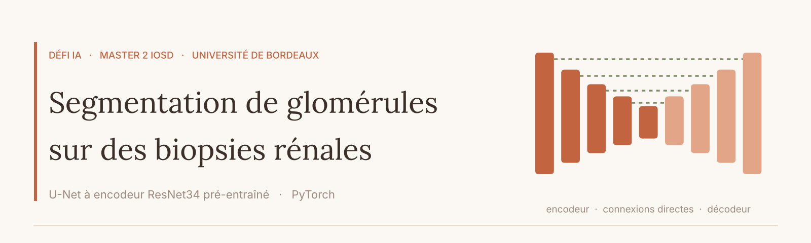
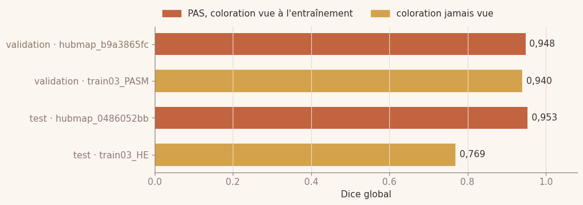
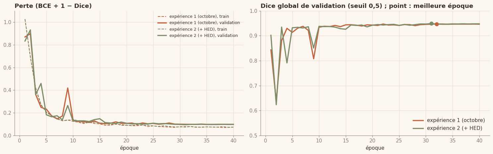
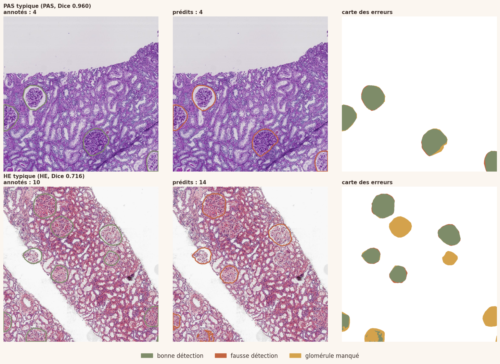

<p align="center">
  
</p>

<p align="center">
  
  
  
  
  
</p>

# Segmentation de glomérules sur des biopsies rénales

Défi IA du Master 2 IOSD (Image, Optimisation et Sciences des Données), Université de Bordeaux, réalisé en binôme.

Les glomérules sont les unités de filtration du rein. Sur une biopsie, le pathologiste les repère pour diagnostiquer une maladie rénale chronique : un travail long et en partie subjectif. L'objectif est de prédire automatiquement leur masque sur des images histologiques de 1024 × 1024 pixels, avec un coefficient de Dice global comme score.

> **Projet en cours (septembre à décembre 2026).** Ce dépôt est mis à jour au fil du projet. Dernière mise à jour : 25 novembre 2026, avec les données finales (462 images). Les chiffres des versions précédentes sont dans l'[historique](#historique-des-versions).

**[Voir le notebook](segmentation_glomerules.ipynb)** · [version mise en forme (nbviewer)](https://nbviewer.org/github/yayefatou-lam/segmentation-glomerules/blob/main/segmentation_glomerules.ipynb)

## En bref

- **Données :** 462 images annotées issues de 9 lames, en trois colorations (PAS, HE, PASM). Les glomérules couvrent 3 à 7 % des pixels.
- **Modèle :** U-Net dont l'encodeur est un ResNet34 pré-entraîné sur ImageNet (24,5 millions de paramètres), entraîné sur des morceaux de 512 × 512 en pleine résolution, avec deux pas d'apprentissage et une décroissance en cosinus.
- **Méthode :** validation et test formés de **lames et de colorations entières**, jamais vues à l'entraînement. L'entraînement ne contient que du PAS, pour imiter le challenge, dont le test contient une coloration absente de nos données (MAS). Tous les choix sont faits sur la validation ; le test n'a servi qu'une fois.
- **Résultat :** Dice global de **0,912** sur le test : **0,953** sur une lame PAS jamais vue, **0,769** sur la coloration HE, jamais vue à l'entraînement.

## Résultats

| Ensemble | Lame ou coloration | Coloration vue à l'entraînement | Images | Dice global |
|---|---|:---:|---:|---:|
| Validation | lame hubmap (PAS) | oui | 94 | 0,948 |
| Validation | lame 4389 en PASM | non | 14 | 0,940 |
| **Test** | lame hubmap (PAS) | oui | 53 | **0,953** |
| **Test** | lame 4389 en HE | non | 15 | **0,769** |
| | | | **Test complet : 68** | **0,912** |



**Ce qui a été testé, puis écarté.** Chaque essai devait améliorer le Dice global de validation de plus de 0,005, seuil fixé à l'avance.

| Essai | Dice de validation | Décision |
|---|---:|---|
| Recette de référence | 0,947 | retenue |
| + augmentation de coloration dans l'espace HED | 0,949 (+ 0,009 sur la PASM) | écartée, gain trop faible |
| + post-traitement : TTA (8 orientations), seuil et suppression des petites taches, 50 combinaisons | 0,949 au mieux | écarté, gain trop faible |



## Analyse des erreurs



Un glomérule annoté est compté comme retrouvé si la prédiction couvre au moins la moitié de ses pixels.

| Test | Glomérules annotés | Retrouvés | Manqués (dont au bord du patch) | Fausses détections |
|---|---:|---:|---:|---:|
| Lame PAS | 172 | 157 (91 %) | 15 (11) | 16 |
| Coloration HE | 73 | 36 (49 %) | 37 (19) | 1 |

- **En PAS**, la plupart des glomérules manqués sont coupés par le bord du patch (11 sur 15), et les fausses détections sont aussi nombreuses que les oublis.
- **En HE**, le modèle oublie un glomérule sur deux, y compris des glomérules entiers au milieu du tissu, mais n'en invente presque pas : face à une coloration inconnue, il devient prudent.
- Sur la PASM, autre coloration jamais vue, le modèle obtient pourtant 0,940 en validation : toutes les colorations nouvelles ne sont pas aussi difficiles.

## Limites

- **Peu de groupes pour évaluer :** la validation et le test reposent chacun sur une lame PAS et une seule coloration nouvelle (14 et 15 images). Le score en HE dépend de peu d'images.
- **Lame 4389 :** ses trois colorations sont réparties entre entraînement (PAS), validation (PASM) et test (HE). Aucune position de patch n'est commune aux trois, mais ces ensembles partagent la même lame, donc le même patient.
- **Coloration MAS absente :** le score sur la coloration du challenge qui manque à nos données ne peut pas être mesuré.
- **Un seul entraînement par recette :** des écarts de 0,002 entre recettes sont du même ordre que la variation d'un entraînement à l'autre.

## Suite du projet

- Choisir l'augmentation sur le score de la coloration la plus difficile, et non sur le Dice global, dominé par le PAS.
- Relancer chaque recette avec plusieurs graines pour mesurer la variation des scores.
- Mieux détecter les glomérules coupés par le bord des patchs, et comprendre pourquoi des glomérules entiers sont manqués en HE.
- Préparer la soumission du challenge avec le modèle final, réentraîné sur les 462 images.

## Lancer le notebook

Le notebook tourne sur Kaggle, Google Colab ou en local, de préférence avec un GPU : environ 20 minutes par entraînement sur un T4. Si les poids d'un entraînement sont déjà présents, ils sont rechargés au lieu d'être réentraînés. Les données ont été fournies dans le cadre du cours et ne sont pas incluses dans ce dépôt, pas plus que les poids.

```bash
pip install -r requirements.txt
```

## Historique des versions

| Version | Données | Découpage | Score sur le test |
|---|---|---|---|
| Octobre 2026 ([notebook archivé](archives/segmentation_glomerules_octobre_2026.ipynb)) | 53 patchs, 2 lames | patchs répartis au hasard au sein des lames | Dice moyen par image 0,883 (0,898 lors d'un autre entraînement) |
| **Novembre 2026** | 462 images, 9 lames, 3 colorations | lames et colorations entières | **Dice global 0,912** |

Les deux scores ne se comparent pas directement : en octobre, le test ressemblait beaucoup à l'entraînement, ce qui rendait le score optimiste, et il était calculé image par image. Mesuré de la même façon, le modèle de novembre obtient un Dice moyen par image de 0,877, du même ordre, mais sur des lames et une coloration jamais vues.

## Auteurs

- **Yaye Fatou Lam** · [LinkedIn](https://www.linkedin.com/in/yaye-fatou-lam-258925412)
- **Imad Asennane**
